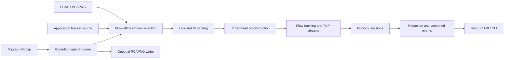

# Architecture and integration contract

## Workspace

| Package | Responsibility |
|---|---|
| `netkit` | Packet/file sources, wire parsing, reconstruction, analysis, discovery, decoder registry, worker pool |
| `netkit-cli` | Command selection, capture scheduling, configuration, output, cancellation |
| `netkit-ffi` | Versioned C ABI over the analysis engine |

The SDK uses independent modules rather than requiring a separate crate for every stage. Parsers, reconstruction and analysis forbid unsafe Rust. Native library loading and C ownership stay in the capture and FFI boundaries. No C++ runtime is required by the core.

## Sources and observations

`Packet` owns captured bytes and carries nanosecond timestamp, original wire length, sensor, interface and link type. Timestamps are capture timestamps, not monotonic process clocks. Give independent observation points different sensor names. Replay files preserve section/interface isolation; the reader uses a file sensor with section suffix, not the writer's original sensor spelling. Imported interface options are not a universal metadata round-trip.

`FlowKey` includes source, VLAN stack, transport and canonically ordered endpoints. Direction 0 is endpoint A to B, not necessarily client to server. Capture-point separation avoids accidentally joining packets from different networks with repeated private addresses. It also means the same conversation observed on multiple interfaces appears more than once.

`DeviceObserved` records evidence, not an authoritative network inventory. ARP, DHCP claims, NDP advertisements and DNS answers can add identity. Plain IP traffic does not attach a router's Ethernet MAC to a remote endpoint. DHCP/DNS names are untrusted claims. The current inventory has no bundled OUI database and no LLDP, SSDP or NetBIOS enrichment; applications can add those through decoder events.

## Streams and uncertainty

IPv4/IPv6 fragments are assembled before transport parsing. Inconsistent fragments and IPv6 overlaps are rejected. Identical IPv4 duplicates are tolerated. TCP orders segments with wrap-aware sequence comparisons, reports retransmission/overlap, retains bounded out-of-order segments, and treats missing ranges as explicit gaps. First-seen queued bytes win conflicting overlaps; delivered historical payload is not retained for unlimited retrospective comparison. This is an observation policy, not guaranteed emulation of every endpoint TCP stack.

SYN distinguishes connection incarnations; retransmitted SYN does not erase state. FIN closes a direction; reset, inactivity, resource eviction and input end close flows. ACK-only packets do not establish an incorrect receive sequence. Flow summaries flag partial capture and carry their close reason. Packet provenance is omitted for messages flushed at input end rather than pointing at an unrelated last packet.

Timeouts use a capture timestamp watermark and a once-per-second sweep. Supply clock-aligned sources to one engine/pool; strongly different sensor clocks can expire each other's state. For independent clocks, use independent engines. The API does not claim packet checksum validation or endpoint TCP acceptance validation.

## Decoder plugins

Register an `Arc<dyn Decoder>` in `ProtocolRegistry`, then use `Engine::with_registry`. A decoder supplies a name, confidence probe and per-direction session. Recognition uses content and transport context. Ports are hints; a forced decoder is also available. Medical decoders do not require their conventional ports.

`DecodeSession::decode(data, context, eof)` returns:

- `NeedMore`: retain the input until more data, EOF or a limit.
- `Skip { consumed }`: consume framing without a message.
- `Message { consumed, message }`: emit one structured message.
- `Invalid { consumed, detail }`: report malformed framing and discard the declared prefix.

Consumption must be positive and no larger than input. The engine checks this contract. Keep internal state bounded and report it through `buffered_bytes()`. `on_gap` signals data discontinuity; the engine then resets the direction's session. `on_close` ends a session. `on_peer_message` receives an unredacted message if the peer direction has the same decoder; HTTP/DICOM peer sessions are created proactively for method/syntax negotiation. Plugin code runs in process; arbitrary plugin panics, resource abuse or sensitive output are not sandboxed by the SDK.

`Completeness` distinguishes `complete`, `partial`, `encrypted`, `opaque` and `unknown`. Complete refers to the decoded unit, not standards certification, whole-connection coverage, or decrypted content. Unrecognized traffic still produces flow observations. Its payload is not placed in default JSON; preserve a PCAPNG file when raw bytes are needed.

## Resource accounting and concurrency

Defaults: 4,096 flows, 16,384 devices, 1 MiB message, 1 MiB retained state per flow, 64 MiB aggregate retained payload, 2 MiB packet, 256 decoder/output-loop bound, 120-second flow and 30-second fragment timeout. Configuration validation rejects invalid or extreme bounds. Diagnostic/control/flow events can exceed the decoder loop count. Finish can return batches across all remaining flows.

`max_total_bytes` measures retained fragment/flow payload and reported session buffers. It is **not a process RSS limit**. Collection capacity, flow/device metadata, parsed JSON trees, event vectors, driver buffers, I/O buffers and queues are additional allocations. Counts, packet sizes, XML depth/node counts, field expansion and HPACK limits bound those separately. Hard process memory ceilings belong in the host application or OS. Custom decoder resource contracts must also be audited.

`AnalysisPool` has fixed bounded input and output queues. Source + VLAN + canonical IP pair determine a worker; transport ports are omitted from the shard hash so non-initial IP fragments reach the same worker. This preserves per-conversation order but may limit scaling when one IP pair dominates. Flow keys themselves still include ports/transport. Total configured flow/device/payload limits are divided among workers. Hot shards can evict before other shards fill.

Callbacks consume output while submitting input, avoiding a full-input/full-output deadlock. Dropping the pool cancels and joins its workers. Rust callbacks may integrate with an application's async runtime; there is no native Tokio `Stream` API in the current SDK. Packet ordering across different workers is not globally sorted. Sequence/flow/packet IDs reserve high bits for worker identity. Merge device evidence across workers by sensor, interface, VLAN and IP when building a unified UI.

The CLI's driver queue drops rather than accumulating without bound; it reports queue drops on shutdown. Driver `ps_drop` and `ps_ifdrop` are reported separately because platform definitions can overlap. Loss counters describe what was measured, not proof that unreported traffic never disappeared upstream.

Sessions with a consumed but unfinished fragmented message expose `has_pending_message()`. Closing the flow reports `incomplete_protocol_state`; an empty input buffer therefore does not silently hide an incomplete ASTM, DICOM, TLS or HTTP/2 assembly.

## Output and ABI

Native events use `schema_version: 1`, sequence, timestamp, source, optional packet ID and tagged event body. Event kinds: packet, device, flow open/close, decoded message, diagnostic, statistics. `JSONL` streams individual objects; `JSON` streams one array. Capture setup warnings are CLI diagnostics and may lack packet provenance. External `deep` records use TShark's schema.

The C ABI version is independent of package metadata. `netkit_abi_version()` returns 1. Functions return 0 success, 1 input/operation failure, 2 caught internal panic, 3 limit, 4 unavailable. Null/length checks cannot validate an arbitrary non-null foreign pointer: the C caller must provide valid memory. Each engine handle requires serialized access. JSON strings returned by netKit must be freed exactly once using `netkit_string_free`. Error strings are borrowed thread-local values. Discard an engine after a caught panic.

The C ABI supports application message decode, packet ingestion, snapshots and finish. For live capture, C/C++ hosts supply packets from their capture layer; the Rust API and CLI also expose the integrated backend. Header exports are checked against the compiled DLL by `tools/verify_ffi.py`; Rust tests check the packet struct layout and ownership behavior. `examples/cpp/main.cpp` demonstrates RAII.

## Configuration and command failures

`netkit config` prints TOML with an `[engine]` table. `--config path` reads it; explicitly supplied positive CLI options override applicable fields. Default output is masked in both SDK and CLI. `--include-sensitive` is an opt-in. Engine configuration does not currently configure capture interface names or scan targets.

CLI exit statuses: 0 success/cancel/broken output pipe, 1 other I/O/runtime error, 2 invalid arguments/configuration, 3 missing capability, 4 capture error, 5 resource limit. Clap emits its own argument help/errors. Diagnostics inside analyzed traffic are events rather than process failure; callers decide their alert policy.
